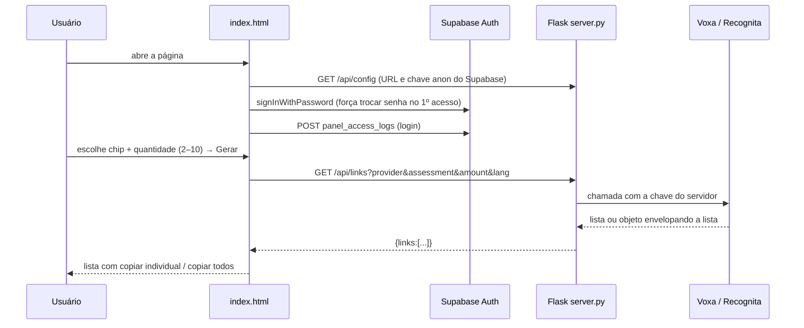

# Gerador de Assessments (`geradordeassessments`) — Documentação técnica e funcional

> Repositório: `tecnologiact/geradordeassessments`. Ferramenta interna de **geração de links de "degustação"** dos assessments da Cia de Talentos (Culturama, Solu, EF, Recognita, Volt) para demonstrações a clientes, validação de produto e testes. Um **servidor Flask** de ~90 linhas faz de proxy para as APIs da **Voxa** e da **Recognita** (mantendo as chaves no servidor) e um único `index.html` traz a interface, o login (Supabase Auth) e o registro de acessos. Inclui ainda um bloco de **instruções padronizadas do Talkia** para enviar ao cliente. Escrito para que alguém que nunca viu o sistema entenda o negócio e consiga **recriá-lo do zero**.

## 1. O que é e para quem serve
**Problema de negócio.** Em reuniões comerciais e de produto, a equipe precisa abrir rapidamente alguns testes para o cliente experimentar — sem usar candidatos reais. A ferramenta gera de **2 a 10 links de acesso** do assessment e idioma escolhidos e os apresenta para copiar.

| Perfil | Uso |
|---|---|
| Comercial, produto e CS da CT | Escolhe assessment + idioma + quantidade, gera e copia links; consulta o texto de instruções do Talkia. |

## 2. Glossário
| Termo | Significado |
|---|---|
| **Link de degustação** | Link de acesso rápido (deep link) a um assessment, para demonstração. |
| **Voxa** | Plataforma que hospeda Culturama, Solu, EF e Volt (execuções identificadas por `executionKey`, ex.: `CULTURAMA_BR`). |
| **Recognita** | Plataforma externa de testes, com API própria (parâmetros `key`, `amount`, `lang`). |
| **Chip** | Botão de seleção de assessment/idioma na tela. |
| **Talkia** | Entrevista por IA; a tela traz só um roteiro de instruções para o cliente. |

## 3. Fluxo


## 4. Arquitetura, stack e arquivos
- **Backend**: Python + Flask + flask-cors + requests + python-dotenv (`server.py`, porta 5000 em dev). Rotas: `/` (serve `index.html`), `/api/config`, `/api/links`.
- **Frontend**: `index.html` (≈1.650 linhas) com CSS, i18n PT-BR/ES embutido, supabase-js carregado por script, geração de links e o painel Talkia.
- Sem build. Deploy não está descrito no repositório (rodar `python server.py` em servidor/VPS).

## 5. Variáveis de ambiente (`.env`)
| Variável | Uso |
|---|---|
| `VOXA_KEY` | Chave da API Voxa. |
| `RECOGNITA_KEY` | Chave da API Recognita. |
| `SUPABASE_URL`, `SUPABASE_ANON_KEY` | Login e log de acessos no front-end (entregues por `/api/config`). |

## 6. Banco de dados
Usa o Supabase compartilhado da CT apenas para **Auth** e para gravar **`panel_access_logs`** (colunas inferidas do código): `user_email`, `panel_name` ("Gerador de Assessments"), `panel_url`, `user_agent`, `event_type`, `event_data`, `created_at`. O `INSERT` é feito pelo navegador com a chave anon (exige política de INSERT para a anon nessa tabela).

## 7. Autenticação
Login por e-mail e senha no navegador (Supabase). `user_metadata.must_change_password` força a troca de senha (mín. 8 caracteres). O código também limpa da URL parâmetros `hub_token` ou `access_token` (retorno de um hub/magic link), mas o tratamento desse token não está neste repositório. **O servidor Flask não valida o login**: a barreira é só a tela (ver §12).

## 8. API
| Rota | Descrição |
|---|---|
| `GET /api/config` | `{supabase_url, supabase_anon_key}`. |
| `GET /api/links?provider=voxa\|recognita&assessment=<KEY>&amount=<n>&lang=` | Voxa: `GET <VOXA_BASE>?key=&executionKey=&isDeepLink=true&amount=`. Recognita: `GET <RECOGNITA_BASE>?key=&amount=[&lang=]`. Normaliza a resposta (lista direta ou envelope em `links`, `data`, `urls`, `executions`, `items`, `results`; itens podem ser texto ou objetos com `url`/`link`/`deepLink`). Erros: 504 timeout, 502 falha na API (inclui corpo), 500 formato inesperado. |

## 9. Regras de negócio
1. **Catálogo de chips** (chave = `executionKey`): Culturama Candidato (`CULTURAMA_BR/EN/ES`), Culturama Gestor (`CULTURAMA_GESTOR_BR/EN/ES`), Solu (`SOLU_BR/EN/ES`), EF (`EF_BR`, global), Recognita (`RECOGNITA_PT/EN/ES`, provider `recognita` com `lang`), Volt (`VOLT_BR/EN/ES`).
2. **Quantidade** de 2 a 10 (padrão 3).
3. Se qualquer item da resposta vier sem URL, a operação falha (não devolve lista parcial).
4. Cada ação relevante registra evento em `panel_access_logs` (login e geração).
5. Interface em PT-BR e ES; link de cada assessment copiável individualmente ou "Copiar todos".
6. As instruções do Talkia são texto fixo no HTML (renderizado por idioma).

## 10. Roteiro para recriar e checklist
1. Obter as chaves das APIs Voxa e Recognita e os endpoints reais.
2. Supabase: usuários (com `must_change_password: true` para novos) e tabela `panel_access_logs` com política de INSERT.
3. Criar `server.py` (Flask), `requirements.txt`, `.env`; criar `index.html`.
4. Rodar `python server.py` e testar cada chip; validar o parsing para os formatos de resposta.
5. Publicar atrás de HTTPS e **proteger as rotas `/api/*`** (ver §12).

**Checklist**: [ ] trocar as URLs `mock` por produção (§12) · [ ] proteger `/api/links` com JWT · [ ] política RLS do log · [ ] limite de quantidade validado no servidor.

## 11. Apêndices — código-fonte real
### 11.1 `server.py`
```python
from flask import Flask, jsonify, request, send_from_directory
from flask_cors import CORS
from dotenv import load_dotenv
import requests
import os

load_dotenv()

app = Flask(__name__, static_folder='.')
CORS(app)

VOXA_BASE      = 'https://mock.voxa.work/'
RECOGNITA_BASE = 'https://api.recognita.com.br/mock'

SUPABASE_URL      = os.getenv('SUPABASE_URL', '')
SUPABASE_ANON_KEY = os.getenv('SUPABASE_ANON_KEY', '')


@app.route('/')
def index():
    return send_from_directory('.', 'index.html')


@app.route('/api/config')
def get_config():
    return jsonify({
        'supabase_url':      SUPABASE_URL,
        'supabase_anon_key': SUPABASE_ANON_KEY
    })


@app.route('/api/links')
def get_links():
    provider   = request.args.get('provider', 'voxa')
    assessment = request.args.get('assessment', '')
    amount     = request.args.get('amount', '3')
    lang       = request.args.get('lang', '')

    try:
        if provider == 'recognita':
            key    = os.getenv('RECOGNITA_KEY')
            params = {'key': key, 'amount': amount}
            if lang:
                params['lang'] = lang
            resp = requests.get(RECOGNITA_BASE, params=params, timeout=15)
        else:
            key    = os.getenv('VOXA_KEY')
            params = {'key': key, 'executionKey': assessment, 'isDeepLink': 'true', 'amount': amount}
            resp = requests.get(VOXA_BASE, params=params, timeout=15)

        resp.raise_for_status()
        data = resp.json()

        # A API pode devolver uma lista direto ou um objeto envelopando a lista
        # (ex: {"links": [...]}, {"data": [...]}, {"urls": [...]}).
        if isinstance(data, dict):
            for wrapper_key in ('links', 'data', 'urls', 'executions', 'items', 'results'):
                if isinstance(data.get(wrapper_key), list):
                    data = data[wrapper_key]
                    break

        if not isinstance(data, list):
            raise ValueError(f'Formato de resposta inesperado da API: {data!r}')

        if data and isinstance(data[0], dict):
            links = [item.get('url') or item.get('link') or item.get('deepLink') for item in data]
        else:
            links = data

        if not links or any(link is None for link in links):
            raise ValueError(f'Não foi possível extrair os links da resposta: {data!r}')

        return jsonify({'links': links})

    except requests.exceptions.Timeout:
        return jsonify({'error': 'Timeout ao contatar a API'}), 504
    except requests.exceptions.RequestException as e:
        body = getattr(e.response, 'text', '')
        return jsonify({'error': f'Erro na requisição: {str(e)}' + (f' — resposta: {body}' if body else '')}), 502
    except Exception as e:
        return jsonify({'error': f'Erro interno: {str(e)}'}), 500


if __name__ == '__main__':
    app.run(port=5000, debug=True)
```
### 11.2 `requirements.txt` e `.env.example`
```text
flask
python-dotenv
requests
flask-cors

# .env.example
VOXA_KEY=
RECOGNITA_KEY=
SUPABASE_URL=https://xxxxxxxxxxxx.supabase.co
SUPABASE_ANON_KEY=
```
### 11.3 Autenticação e log no front-end (trecho de `index.html`)
```javascript
async function initAuth() {
  showLoginScreen();

  let config = {};
  try {
    const r = await fetch('/api/config');
    config = await r.json();
  } catch {
    showLoginScreen('Não foi possível conectar ao servidor.');
    return;
  }

  if (!config.supabase_url) {
    showLoginScreen('Autenticação não configurada no servidor.');
    return;
  }

  _config = config;
  _sb = window.supabase.createClient(config.supabase_url, config.supabase_anon_key, { auth: { persistSession: false } });

  _sb.auth.onAuthStateChange(async (event, session) => {
    if (session) {
      await onAuthenticated(session.user);
    } else if (event === 'INITIAL_SESSION') {
      showLoginScreen();
    }
  });
}

async function onAuthenticated(user) {
  // Limpa parâmetros do hub ou hash do magic link da URL
  if (window.location.search.includes('hub_token') || window.location.hash.includes('access_token')) {
    history.replaceState({}, '', window.location.pathname);
  }

  if (user.user_metadata?.must_change_password) {
    showChangePwScreen();
  } else {
    showApp(user);
  }
}

let _currentUser = null;

function logEvent(eventType, eventData) {
  if (!_currentUser || !_config.supabase_url) return;
  fetch(_config.supabase_url + '/rest/v1/panel_access_logs', {
    method:  'POST',
    headers: {
      'Content-Type': 'application/json',
      'apikey':       _config.supabase_anon_key,
      'Prefer':       'return=minimal'
    },
    body: JSON.stringify({
      user_email: _currentUser.email,
      panel_name: 'Gerador de Assessments',
      panel_url:  window.location.href,
      user_agent: navigator.userAgent,
      event_type: eventType,
      event_data: eventData
    })
  }).then(r => { if(!r.ok) r.text().then(t => console.error('[logEvent]', t)); })
    .catch(e => console.error('[logEvent]', e));
}

function showApp(user) {
  _currentUser = user;
  hideOverlay();
  const zone = document.getElementById('user-zone');
  zone.classList.add('visible');
  document.getElementById('user-email-display').textContent = user.email;
  logEvent('login', {});
}

function hideOverlay() {
  document.getElementById('auth-overlay').style.display = 'none';
}

function showLoginScreen(errorMsg) {
  document.getElementById('auth-overlay').style.display = 'flex';
  document.getElementById('login-screen').style.display = '';
  document.getElementById('change-pw-screen').style.display = 'none';
  if (errorMsg) document.getElementById('login-error').textContent = errorMsg;
}

function showChangePwScreen() {
  document.getElementById('auth-overlay').style.display = 'flex';
  document.getElementById('login-screen').style.display = 'none';
  document.getElementById('change-pw-screen').style.display = '';
}

// Login
document.getElementById('login-btn').addEventListener('click', async () => {
  const email    = document.getElementById('login-email').value.trim();
  const password = document.getElementById('login-password').value;
  const errorEl  = document.getElementById('login-error');
  const btn      = document.getElementById('login-btn');

  if (!email || !password) { errorEl.textContent = 'Preencha e-mail e senha.'; return; }
  if (!_sb) { errorEl.textContent = 'Servidor indisponível. Recarregue a página.'; return; }

  btn.disabled = true;
  btn.textContent = 'Entrando…';
  errorEl.textContent = '';

  const { error } = await _sb.auth.signInWithPassword({ email, password });
```
### 11.4 Geração de links no front-end (trecho de `index.html`)
```javascript
let qty = 3;

  // ── Single-select chips ──────────────────────────────
  const chips = document.querySelectorAll('.chip');

  let selectedAssessment = { key: 'CULTURAMA_BR', provider: 'voxa', lang: null };

  function syncChipUI() {
    chips.forEach(c => c.classList.toggle('active', c.dataset.key === selectedAssessment.key));
  }

  chips.forEach(chip => {
    chip.addEventListener('click', () => {
      selectedAssessment = {
        key: chip.dataset.key,
        provider: chip.dataset.provider || 'voxa',
        lang: chip.dataset.lang || null
      };
      syncChipUI();
    });
  });

  syncChipUI();

  async function fetchLinks() {
    const a      = selectedAssessment;
    const params = new URLSearchParams({ provider: a.provider, assessment: a.key, amount: qty });
    if (a.lang) params.set('lang', a.lang);
    const resp = await fetch('/api/links?' + params);
    const body = await resp.json();
    if (!resp.ok) throw new Error(body.error || 'Erro desconhecido');
    return body.links;
  }

  // ── Quantity ─────────────────────────────────────────
  const qtyDisplay = document.getElementById('qty-display');
  const btnMinus = document.getElementById('btn-minus');
  const btnPlus = document.getElementById('btn-plus');

  function updateQtyBtns() {
    btnMinus.disabled = qty <= 2;
    btnPlus.disabled = qty >= 10;
  }

  btnMinus.addEventListener('click', () => {
    if (qty > 2) { qty--; qtyDisplay.textContent = qty; updateQtyBtns(); }
  });
  btnPlus.addEventListener('click', () => {
    if (qty < 10) { qty++; qtyDisplay.textContent = qty; updateQtyBtns(); }
  });
  updateQtyBtns();

  // ── Generate ──────────────────────────────────────────
  function getLabelForAssessment(key) {
    const el = document.querySelector(`.chip[data-key="${key}"]`);
    if (!el) return key;
    // Get group label above this chip's chip-grid
    let node = el.closest('.chip-grid').previousElementSibling;
    const group = node ? node.textContent.trim() : '';
    return group + ' · ' + el.textContent.trim();
  }

  function renderGroups(groups, allLinks) {
    const container = document.getElementById('links-container');
```

## 12. Pontos de atenção
| # | Achado | Impacto / recomendação |
|---|---|---|
| 1 | **`/api/links` e `/api/config` são públicos**: o login existe só no navegador | Qualquer pessoa que descubra a URL consome as chaves da Voxa/Recognita e gera links ilimitados. **Prioridade alta**: validar o JWT do Supabase no Flask e limitar quantidade/taxa no servidor. |
| 2 | As bases `VOXA_BASE = https://mock.voxa.work/` e `RECOGNITA_BASE = https://api.recognita.com.br/mock` apontam para ambientes **mock** | Os links gerados podem não ser os de produção; confirmar intencionalidade e parametrizar por variável de ambiente. |
| 3 | `CORS(app)` liberado para qualquer origem e `debug=True` no `app.run` | Em produção, `debug` expõe o console do Werkzeug; restringir origens e usar gunicorn. |
| 4 | Mensagens de erro devolvem o corpo da resposta externa (`resposta: ...`) | Pode vazar detalhes internos; mascarar. |
| 5 | O log de acessos é gravado pelo navegador com a chave anon | Falsificável; registrar no servidor. |
| 6 | A quantidade (2–10) é validada só na interface | Validar no servidor. |
| 7 | Dados de "degustação" misturam-se aos de produção se as chaves forem de produção | Usar contas separadas e nunca candidatos reais. |
| 8 | Sem testes e `index.html` monolítico | Dificulta manutenção. |
